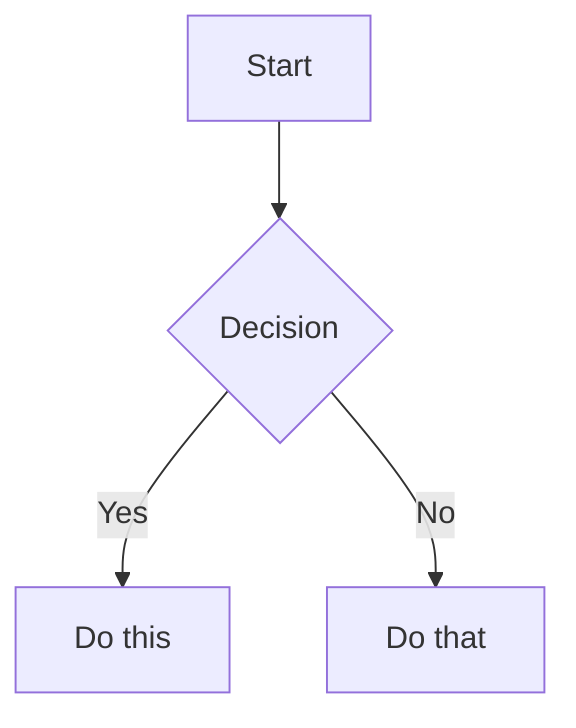

# Obsidian Flavored Markdown Skill

> **Adapted for the LoopyLuci Skills collection** from [obsidianmd/obsidian-skills](https://github.com/obsidianmd/obsidian-skills). The guidance below is rewritten and condensed for this repo; commands, paths, and reference tables are preserved.

## Trigger

- Working with .md files in Obsidian, or when the user mentions wikilinks, callouts, frontmatter, tags, embeds, or Obsidian notes

## When NOT to Use

- Outside the trigger above; keep the task in the skill that owns it.

## Overview

Create and edit valid Obsidian Flavored Markdown. Obsidian extends CommonMark and GFM with wikilinks, embeds, callouts, properties, comments, and other syntax; this skill covers only the Obsidian-specific extensions and assumes standard Markdown knowledge.

## Creating a note

1. Add frontmatter properties (title, tags, aliases) at the top — see `references/PROPERTIES.md`.
2. Write content with standard Markdown plus the Obsidian syntax below.
3. Link related notes with wikilinks (`[[Note]]`) for vault-internal connections, or standard Markdown links for external URLs.
4. Embed notes, images, or PDFs with `![[embed]]` — see `references/EMBEDS.md`.
5. Add callouts with `> [!type]` — see `references/CALLOUTS.md`.
6. Verify the note renders correctly in reading view.

Choose wikilinks for notes inside the vault (Obsidian tracks renames automatically) and `[text](url)` for external URLs only.

## Wikilinks

```markdown
[[Note Name]]                          Link to note
[[Note Name|Display Text]]             Custom display text
[[Note Name#Heading]]                  Link to heading
[[Note Name#^block-id]]                Link to block
[[#Heading in same note]]              Same-note heading link
```

Inside Markdown tables, escape the alias pipe as `[[Note\|Alias]]` so it is not read as a cell delimiter, and leave a blank line above a table that follows a paragraph or it renders as plain text.

Links resolve by file name, not by the `aliases` property: a bare `[[Alias]]` stays unresolved, so write `[[Note|Alias]]` to display an alias.

Define a block ID by appending `^block-id` to a paragraph:

```markdown
This paragraph can be linked to. ^my-block-id
```

For lists and quotes, put the block ID on its own line after the block:

```markdown
> A quote block

^quote-id
```

## Embeds

Prefix a wikilink with `!`:

```markdown
![[Note Name]]                         Embed full note
![[Note Name#Heading]]                 Embed section
![[image.png]]                         Embed image
![[image.png|300]]                     Embed image with width
![[document.pdf#page=3]]               Embed PDF page
```

`references/EMBEDS.md` covers audio, video, search embeds, and external images.

## Callouts

```markdown
> [!note]
> Basic callout.

> [!warning] Custom Title
> Callout with a custom title.

> [!faq]- Collapsed by default
> Foldable callout (- collapsed, + expanded).
```

Common types: `note`, `tip`, `warning`, `info`, `example`, `quote`, `bug`, `danger`, `success`, `failure`, `question`, `abstract`, `todo`. `references/CALLOUTS.md` lists aliases, nesting, and custom CSS callouts.

## Properties

```yaml
---
title: My Note
date: 2024-01-15
tags:
  - project
  - active
aliases:
  - Alternative Name
cssclasses:
  - custom-class
---
```

Default properties: `tags` (searchable labels), `aliases` (alternatives offered in link suggestions; links still use the file name), `cssclasses` (styling). See `references/PROPERTIES.md` for all types and tag syntax rules.

## Tags

```markdown
#tag                    Inline tag
#nested/tag             Nested tag with hierarchy
```

Tags may contain letters, numbers, underscores, hyphens, and forward slashes, and must include at least one non-numerical character (`#1984` is invalid; `#1984book` is valid). A space ends a tag, so `#my tag` is the tag `#my`. Tags may also be defined in frontmatter under `tags`.

## Comments

```markdown
This is visible %%but this is hidden%% text.

%%
This entire block is hidden in reading view.
%%
```

## Other Obsidian formatting

```markdown
==Highlighted text==                   Highlight syntax
==🔴Highlighted text==                 Colored highlight (Obsidian 1.14.1+)
```

A colored highlight starts with 🔴, 🟠, 🟡, 🟢, 🔵, or 🟣 (or the matching square) immediately after `==`; other emoji stay as text.

Math:

```markdown
Inline: $e^{i\pi} + 1 = 0$

Block:
$$
\frac{a}{b} = c
$$
```

Diagrams:

`````markdown

`````

Add `class NodeName internal-link;` to link Mermaid nodes to notes.

Footnotes:

```markdown
Text with a footnote[^1].

[^1]: Footnote content.

Inline footnote.^[This is inline.]
```

## Worked example

`````markdown
---
title: Project Alpha
date: 2024-01-15
tags:
  - project
  - active
status: in-progress
---

# Project Alpha

This project aims to [[improve workflow]] using modern techniques.

> [!important] Key Deadline
> The first milestone is due on ==January 30th==.

## Tasks

- [x] Initial planning
- [ ] Development phase
  - [ ] Backend implementation
  - [ ] Frontend design

## Notes

The algorithm uses $O(n \log n)$ sorting. See [[Algorithm Notes#Sorting]] for details.

![[Architecture Diagram.png|600]]

Reviewed in [[Meeting Notes 2024-01-10#Decisions]].
`````

## References

- https://help.obsidian.md/obsidian-flavored-markdown
- https://help.obsidian.md/links
- https://help.obsidian.md/embeds
- https://help.obsidian.md/callouts
- https://help.obsidian.md/properties

## Verification

- [ ] Frontmatter valid; links, embeds, and callouts use Obsidian syntax.
- [ ] Wikilinks used for vault notes, Markdown links for external URLs.
- [ ] Block IDs placed correctly for lists and quotes.
- [ ] Note renders as intended in reading view.

## Related Skills in This Repo

- [obsidian-bases](../obsidian-bases/SKILL.md) — Use when working with .base files, creating database-like views of notes, or when the user...
- [json-canvas](../json-canvas/SKILL.md) — Use when working with .canvas files, creating visual canvases, mind maps, flowcharts, or w...
- [obsidian-cli](../obsidian-cli/SKILL.md) — Use when the user asks to interact with their Obsidian vault, manage notes, search vault c...
- [knap](../knap/SKILL.md) — Use when the user asks to apply a Knap template, turn JSON or CSV data into notes, batch-g...
- [obsidian-vault](../obsidian-vault/SKILL.md) — Use when searching, creating, or managing notes in an Obsidian vault
- [obsidian-note-taking-workflow](../obsidian-note-taking-workflow/SKILL.md) — Use when implementing Obsidian workflows.
- [obsidian](../obsidian/SKILL.md) — Read, search, create, and edit notes in the Obsidian vault.

## Adaptation Notes

- Description rewritten into this repo's trigger form.
- Trigger and When-NOT-to-Use sections derived from the upstream guidance.
- Body condensed and restructured; commands, file paths, and tables preserved.
- Related skills linked from this repo.
- Upstream branding and attribution lines removed (attribution below).

## Source & Attribution

- Upstream: [obsidianmd/obsidian-skills](https://github.com/obsidianmd/obsidian-skills)
- Path: `_sources/obsidianmd_obsidian-skills/plugins/obsidian/skills/obsidian-markdown/SKILL.md`
- License: MIT — Copyright (c) 2026 Steph Ango (@kepano)
- Retrieved: 2026-11-14; rewritten and condensed by LoopyLuci Community.
